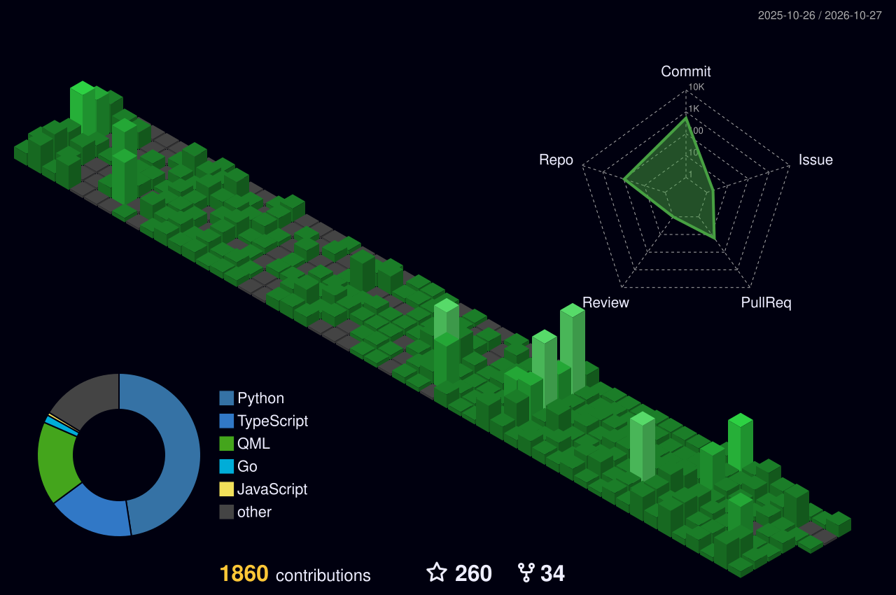

<!-- Welcome typing animation -->
<!-- <h1 align="center">
  
</h1> -->

###
<h1 align="center">

  

</h1>
<h1 align="center">👋 Hi, I'm Filippo De Silva</h1>
<h3 align="center">Full Stack Software Engineer • Application Security • Toolmaker</h3>

  

---

## 🧠 About Me

I'm **Filippo** — a Full Stack Software Engineer passionate about building reliable systems, simplifying complex workflows, and integrating security into the software development lifecycle.

My experience spans fintech systems, backend services, payment integrations, developer SDKs, and performance optimization. I enjoy understanding how systems work under the hood, identifying weaknesses, and turning what I learn into practical solutions.

- 🛠️ **Builder at heart** — production systems, full-stack applications, and developer tools.
- 🔐 **Security-minded engineer** — application security, API security, vulnerability assessment, and secure development.
- ⚙️ **Systems thinker** — backend architecture, database optimization, integrations, and performance engineering.
- 📦 **Currently exploring** — automation, developer tooling, and the BlackRaven webapp.

> *"First, solve the problem. Then, write the code."* — John Johnson

---

## ⚙️ Tech Stack

| Category | Tools |
|---|---|
| **Frontend** | Next.js, React, TypeScript, Tailwind CSS |
| **Backend** | Node.js, NestJS, Express, Python, Go |
| **Automation** | Bash, PowerShell, Python |
| **Security** | Application Security, API Security, JWT, RBAC, HMAC, Vulnerability Assessment |
| **Database & Caching** | PostgreSQL, MongoDB, Redis |
| **Infrastructure & Platforms** | Docker, Supabase, Firebase, Clerk, Convex |
| **Testing & Monitoring** | Vitest, Postman, Sentry |
| **Operating Systems** | Linux, Kali Linux, Windows |

---

  

| Project | Description | Tech |
|---|---|---|
| 🐧 [**Kali Land**](https://github.com/FilippoDeSilva/kali-land) | A modular, customizable Kali Linux environment inspired by opinionated developer distributions, with reproducible configurations, pinned dependencies, and a tailored desktop workflow. | Linux, Kali, Bash, Hyprland, Quickshell |
| 🧪 [**AutoTest**](https://auto-test-landing.vercel.app) | A developer-tooling project exploring automated test generation and streamlined testing workflows to reduce repetitive work and improve development feedback loops. | Testing Automation, VS Code, CI/CD |
| 🎬 [**GoPlay**](https://github.com/FilippoDeSilva/go-play) | A personal movie and TV application built around a streaming-style experience, combining media discovery with a modern, responsive interface. | Next.js, TypeScript, Tailwind CSS, TMDB |
| 🎓 [**Class Unity SMS**](https://github.com/FilippoDeSilva/class-unity-fullstack-SMS) | A full-stack school management platform bringing academic workflows, role-based access, communication, and resource sharing into one application. | Next.js, TypeScript, Prisma, PostgreSQL, Clerk, Supabase, Stream Chat |
| 🔓 [**Wi-Fi Bruteforce**](https://github.com/FilippoDeSilva/Wi-Fi-Bruteforce) | A multithreaded Python security experiment exploring password-guessing workflows and concurrent execution. | Python, Multithreading |
| 📥 [**Cursor AI Bypass**](https://github.com/FilippoDeSilva/cursor-ai-bypass) | An experimental Python utility exploring account identifiers and usage-limit detection in a developer tool. | Python |

> *"I build tools I wish existed."*

---

## 🏗️ Professional Engineering

My professional work spans fintech engineering, developer tooling, third-party integrations, and application security. I focus on solving production problems, improving existing systems, and building reusable components that make software more performant, secure, and easier to integrate.

### 💳 YaYa Wallet — Full Stack Software Engineering

**Production fintech systems · Backend architecture · Payment integrations**

- **Dashboard architecture & performance:** Rebuilt the internal dashboard and migrated the business dashboard to a modernized architecture, addressing performance bottlenecks and improving responsiveness across business workflows.
- **API & database optimization:** Combined frontend query caching, Redis-backed backend caching, and PostgreSQL query and index optimization to achieve approximately **3× average API performance improvement**.
- **Payment SDK engineering & integration support:** Developed Node.js and Go payment gateway SDKs, including tests and publishing workflows, and supported third-party organizations—including PSOs, PIIs, and other fintech companies—in integrating with the gateway more efficiently.
- **Secure backend services:** Built and improved NestJS/TypeScript services, incorporating JWT-based authentication, role-based access control (RBAC), and transactional workflows designed around ACID principles.
- **Security remediation:** Collaborated with the Information Network Security Administration (INSA) to address application security findings and support security and compliance improvements.
- **Transaction approval workflows:** Designed, implemented, tested, and deployed an approval workflow engine for transactions requiring authorization before funds could leave an account. The system supports configurable approval thresholds and approver decisions, including pending and rejection states.

### 🔐 Ghion Financial — Application Security & Integrations

**Web application security · SDK development · Third-party integrations**

- **Security assessment:** Conducted web application vulnerability assessments and security testing to identify weaknesses and support remediation.
- **Developer SDKs:** Worked on Node.js and Go SDKs to simplify integration with payment-related services.
- **Third-party integrations:** Contributed to integrations with payment service organizations (PSOs), payment instrument issuers (PIIs), fintech companies, and other external partners, helping them connect to relevant services using the available SDKs.

### ⚙️ Engineering Principles

- **Performance is measurable:** Identify bottlenecks, optimize the right layer, and validate the impact.
- **Security is part of engineering:** Consider authentication, authorization, input handling, and failure cases throughout development.
- **Good abstractions help other developers:** Build APIs and SDKs that reduce integration complexity rather than add to it.
- **Ownership means delivery:** Take problems from investigation through implementation, testing, and integration.

My approach is to understand the system, solve the underlying problem, and deliver improvements that matter beyond the code itself.

## 📈 GitHub Stats

  <picture>
    <source media="(prefers-color-scheme: dark)" srcset="https://github-profile-summary-cards.vercel.app/api/cards/profile-details?username=FilippoDeSilva&theme=github_dark" />
    <source media="(prefers-color-scheme: light)" srcset="https://github-profile-summary-cards.vercel.app/api/cards/profile-details?username=FilippoDeSilva&theme=default" />
    
  </picture>

  <picture>
    <source media="(prefers-color-scheme: dark)" srcset="https://github-profile-summary-cards.vercel.app/api/cards/stats?username=FilippoDeSilva&theme=github_dark" />
    <source media="(prefers-color-scheme: light)" srcset="https://github-profile-summary-cards.vercel.app/api/cards/stats?username=FilippoDeSilva&theme=default" />
    
  </picture>

  

---

### GitHub Contributions

<!-- Snake animation commented out

  

-->

  

###

## 🌐 Connect with Me

  
  
  

---

> ⏰ *Nothing easy is worth doing!*

<!-- Footer SVG -->

